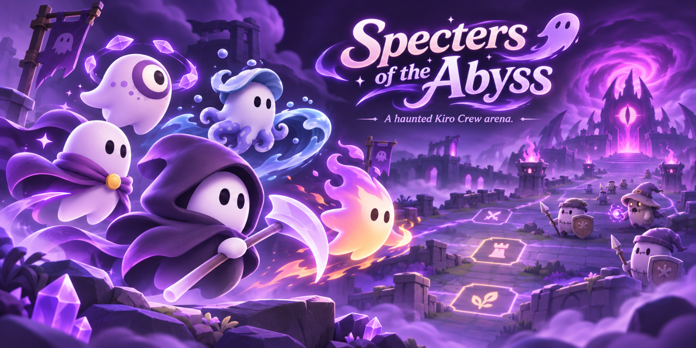

# Specters of the Abyss

A Kiro Crew app, built in the open for Kiroween 2026. Specters of the Abyss watches the Kiro Crew bots you choose, lets you give each one a named Specter (assigned by you, or randomly), turns the work it observes into XP automatically, and shows the result in a small read-only arena with an evidence inspector. XP reflects observed activity: a task that ends cleanly while the app was watching. It does not check that the outcome was right, and no person accepts anything. It runs inside your own Kiro Crew; there is no hosted version. To try it, see [Install a release](#install-a-release).

Status: a proof of concept. Known limits are in `docs/submission/known-limitations.md`.

## Prerequisites

- Node 22 or newer and npm to build (`package.json` `engines`). `.nvmrc` pins Node 26 and npm 11 for development and CI, and release artifacts are built on it
- Python 3.12 and uv 0.13 (`.python-version` pins 3.12, the version Crew bundles)

## Commands

Run these from the repository root on a fresh checkout:

```sh
npm ci
npm run lint
npm run typecheck
npm test
npm run coverage
```

| Command | What it does |
|---|---|
| `npm run lint` | ESLint, then `ruff check` and `ruff format --check` over `backend/` |
| `npm run typecheck` | `tsc --noEmit` over `scripts/` and `ui/`, then mypy strict over `backend/` |
| `npm test` | Node's built-in test runner over `scripts/__tests__/`, Vitest over `ui/src/`, then pytest over `backend/` |
| `npm run coverage` | Tests with coverage; fails under 90% lines on `scripts/*.mjs`, `ui/src/` or `backend/specter_arena` |
| `npm run check:lock` | Checks that every native package family in the lock has a linux-x64 glibc build, and that `requirements.txt` matches `backend/uv.lock` |
| `npm run check:provenance` | Checks for Dragonboat-only identifiers, a tracked `.kiro/`, and no tracked env files |
| `npm run build` | Vite library build of the UI to `ui/dist/index.mjs`, with the host-provided modules left external |
| `npm run build:preview` | Builds the FIXTURE preview harness to `ui/preview-dist/` |
| `npm run test:e2e` | Builds the harness and runs the Playwright Chromium smoke test against it |
| `npm run check:fixtures` | Fails if `ui/dist/` carries fixture code or the backend runtime imports tests or fixtures |
| `npm run build:diagnostic` | Dev-only diagnostic bundle to `ui/diagnostic-dist/` (never shipped; carries `SPECTER-DIAGNOSTIC-ONLY`) |
| `npm run check:diagnostic` | Positive control: the diagnostic bundle still carries its marker, so the `check:fixtures` exclusion scan is meaningful |
| `npm run probe:check` | Offline validation of the committed capability matrix and recorded payloads; not a live probe |
| `npm run probe:stage` | Assembles the git-ignored `.probe-app/` (release app plus probe overlay; `-- --phase v0\|v1\|v2`) for the owner to install; prints the install command, never installs |
| `npm run check:schema` | Offline validation of the contract schemas, their cases and owner table, the FP-02-AC06 denylist, and the spec-id registry |
| `npm run dev` | Serves the FIXTURE preview harness with Vite's dev server (no backend) |
| `npm run package -- --commit <sha>` | Builds the release artifact from that commit in a clean temporary clone and writes `.release/specter-arena-<version>-<sha12>.tar.gz` plus its `.sha256`; fails on denied paths or fixture/diagnostic markers; never publishes |

Run `npm ci && npm run build` before installing this repo into Crew from a local path: a local-path install copies the folder without building it, and Crew loads `ui/dist/index.mjs`.

## Install a release

The recommended route is the Kiro Crew registry: add `https://github.com/burlabs/specter-arena` with branch `release` under External Registries. The branch is prebuilt, so no Node or npm is needed; `main` is source only and lists nothing in a registry. See "Install from the registry" in `docs/release/install.md` (section 2A). The fallback is a release artifact, not a checkout: download `specter-arena-<version>-<sha12>.tar.gz` and its `.sha256` from the GitHub Release, verify, extract and follow `docs/release/install.md`. The owner refreshes the `release` branch with `npm run release:branch` (see `docs/release/install.md`, section 11A). Maintainers build the artifact from a pinned commit with `npm run package -- --commit <sha>` (see `docs/release/install.md`, "Building the artifact"); the output goes to the git-ignored `.release/`.

## Kiro Crew avatar packs (optional)

The repository also holds an optional set of Kiro Crew avatar packs, one for each of the 11 Specters. A pack is a Crew avatar appearance you can give to any of your bots. It is separate from the app's hero assignment: the app never installs or assigns these packs, and they are not part of the release artifact. The Specters tab links to the matching file on GitHub, so opening the link needs a network connection.

- [Vell](avatar-packs/packs/specters-vell.pack.json)
- [Stitch](avatar-packs/packs/specters-stitch.pack.json)
- [Reeve](avatar-packs/packs/specters-reeve.pack.json)
- [Rattle](avatar-packs/packs/specters-rattle.pack.json)
- [Ember](avatar-packs/packs/specters-ember.pack.json)
- [Shard](avatar-packs/packs/specters-shard.pack.json)
- [Poly](avatar-packs/packs/specters-poly.pack.json)
- [Tide](avatar-packs/packs/specters-tide.pack.json)
- [Lume](avatar-packs/packs/specters-lume.pack.json)
- [Moss](avatar-packs/packs/specters-moss.pack.json)
- [bur](avatar-packs/packs/specters-bur.pack.json)

To use one, download its `.pack.json` file, then in Crew open Avatar → Customize → Library → Import and select the file. Crew refuses to import a pack whose id is already installed, so to update a pack, delete the old one from the Library first. See `avatar-packs/README.md` for details.

## Documentation

- `AGENTS.md`: guidance for coding agents
- `CONTRIBUTING.md`: lockfile rules and local checks
- `SECURITY.md`: secret handling
- `docs/development/adapters.md`: SOP provider keys and the CI check list
- `docs/architecture/component-index.md`: component ownership
- `docs/ops/preview.md`: the per-PR preview stack and how the owner deploys it
- `docs/compatibility/`: the pinned Crew compatibility record, capability matrix and host facts
- `docs/ops/crew-probe-runbook.md`: the live probe runbook
- `docs/development/probe-slice1-runbook.md`: the FP-02+03 slice-1 owner sitting
- `docs/provenance.md` and `DEPENDENCIES.md`: where things come from
- `docs/release/install.md`, `docs/release/judge-access.md`: install, update, uninstall and judge access
- `docs/submission/`: write-up drafts, rules checklist and demo script

## License

MIT. See `LICENSE`.
